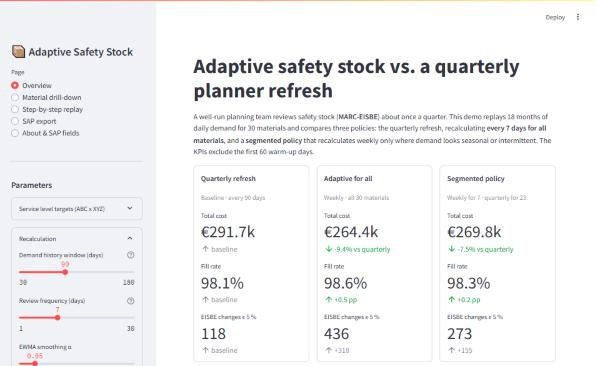
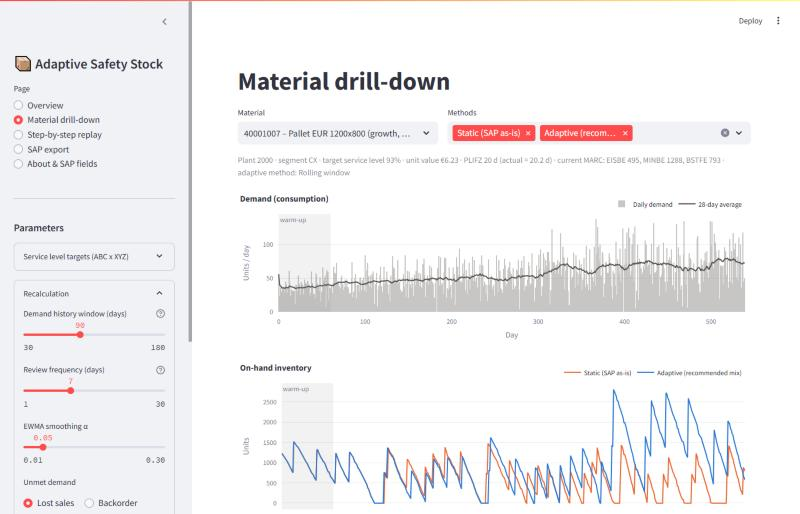
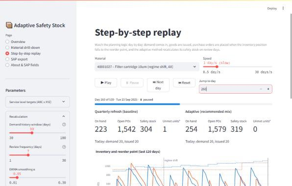

# Adaptive Safety Stock for SAP MM

**What does weekly, automatic safety stock recalculation add on top of a disciplined quarterly
planner review? An honest simulation, with SAP field names and an approval workflow.**



---

## The problem

In SAP MM, the safety stock (`MARC-EISBE`) and, for reorder-point items, the reorder point
(`MARC-MINBE`) are maintained by planners. In a well-run team they are reviewed about once a
quarter. In many teams they are reviewed far less often.

Between reviews, demand keeps moving. Products slowly grow or decline, a customer changes its
order pattern, seasons come and go, and suppliers become more or less reliable. A quarterly value
is always a little behind. The question this project asks is deliberately modest:

> If a background job recalculated EISBE every week from data SAP already holds, how much better
> would we do than a planner who refreshes it every quarter?

## The approach

The weekly job uses only data that SAP already holds:

1. **Demand** is read from consumption history (goods issues in MSEG, monthly totals in MVER).
2. **Real supplier lead times** come from purchasing history: PO date (`EKKO-BEDAT`) to goods receipt
   (`EKBE-BUDAT`, movement type 101). The planned delivery time `PLIFZ` is not used for this,
   because it is often out of date.
3. **Segmentation** uses ABC (consumption value) × XYZ (demand variability). Each segment gets a target
   service level, from 98% for AX items down to 90% for CZ items.
4. The job computes a **new safety stock** with the method that fits the demand type:
   * regular demand: `SS = z · √(LT_mean · σ_d² + d_mean² · σ_LT²)` on a rolling 90-day window
   * intermittent / lumpy demand: an empirical percentile of observed lead-time demand
   * EWMA is also simulated as an alternative.
5. **Planner control** decides what gets posted. Changes under 5% are ignored, so the master data
   does not flicker. Changes up to ±30% are posted automatically through an MM17/LSMW file. Anything
   larger goes to the responsible MRP controller for approval, with a plain-language reason.

**The baseline is a fair one.** The planner uses the same formula and the same 90-day window, but
recalculates only every 90 days. A setting that is never updated is also simulated, but only as a
secondary reference. Comparing against neglected master data would make any method look good.

**The scenario is realistic:**

* 30 materials, 540 days (18 months), daily reorder-point (s, Q) policy, stochastic lead times.
* Demand changes are mild: trends of ±10–25% over the whole horizon, and level shifts of ±10–25%
  combined with a 1.5× jump in volatility. Seasonal items swing ±30–50% over the year.
* Stockout cost is 1.5 × the unit margin, with a 25% margin assumed. That is 37.5% of the unit
  value. Holding cost is 20% per year, and each order costs €50.
* Every method sees exactly the same demand and the same supplier delays, so any difference in the
  results comes from the safety stock logic alone.

No parameter was tuned to reach a particular result. The cost assumptions were fixed before the
simulation was run.

## Results

**Weekly recalculation lowers total cost by 9.4% compared with a quarterly refresh**, from about
€292k to €264k over the 16-month evaluation period. Fill rate rises slightly, from 98.1% to
98.6%, and average inventory value is about 1% lower. Most of the saving comes from avoided
stockouts. Holding and ordering costs barely move.

That is more than the few percent people usually expect, so it is worth being precise about
where it comes from:

* **Seasonal materials account for almost all of it** (about €26k of the €27k). A quarterly
  refresh always looks at the last 90 days, so it sets the safety stock for the season that has
  just ended. It is too low going into the peak and too high coming out of it. The clearest case is
  the PCB control board (AY): same average inventory, but its stockout cost falls from about €17k to
  €2k because the weekly job raises the safety stock *as* demand climbs. The drill-down chart below
  shows this.
* **Without the seasonal items, the saving is about 0.5%.** Growth, decline and regime-shift
  materials are essentially break-even. A quarterly review already catches mild trends and one-off
  level shifts well enough.
* **Intermittent materials improve by about 11%.** This is partly the weekly cycle and partly the
  empirical percentile method, which suits lumpy demand better than the normal formula. If every
  item used the same formula weekly, the overall saving would be 8.8% instead of 9.4%.
* **Stable materials get slightly worse (+2.5% cost).** With nothing to adapt to, weekly
  recalculation mostly adds estimation noise. The deep groove ball bearing (AY) is the biggest
  loser, at about €5k worse. This is exactly why the export has a dead band and an approval step.

Adaptive is cheaper for 20 of the 30 materials, not all of them. Its total-cost advantage depends on
the stockout cost assumption: 7.1% at 1× margin and 11.1% at 2× margin. In every case, more than 90%
of it comes from seasonal items. With a 60-day window it falls to 5%, with a 180-day window to 2%,
and with monthly instead of weekly reviews to 7%.

**What this means in practice:** an automatic weekly job pays off where demand changes *within* a
quarter, which mainly means seasonal items. For the rest of the portfolio it mainly saves planner
time rather than money. A forecast-based safety stock would probably do better still on seasonal
items, because it would anticipate the season instead of following it.

*Reference:* a never-updated safety stock would cost about €320k with a 96.9% fill rate, about
10% more than the quarterly refresh. It is not used for the headline.

### Segmented policy: weekly only where it should pay off

If almost all of the benefit comes from seasonal and intermittent items, why recalculate the
others weekly at all? The **segmented policy** recalculates weekly only for materials that *look*
seasonal or intermittent in the **12 months of consumption before go-live**. All other materials
keep the quarterly refresh. The classification uses only demand data, never the generator's
labels:

* **Seasonal** if the seasonality strength is ≥ 0.6. The strength is measured on weekly totals,
  after removing a linear trend, by fitting one yearly wave.
* **Intermittent** if the average interval between demands (ADI) is above 1.32, the
  Syntetos–Boylan cut-off. CV² is reported alongside it for the full smooth / erratic /
  intermittent / lumpy classification.

Both thresholds were fixed before any results were looked at. 7 of 30 materials qualify for
weekly review.

| Policy | Total cost | vs. quarterly | Fill rate | EISBE changes ≥ 5% |
|---|---|---|---|---|
| Quarterly refresh (baseline) | €291.7k | — | 98.1% | 118 |
| Adaptive for all (weekly) | €264.4k | −9.4% | 98.6% | 436 |
| **Segmented policy** | €269.8k | −7.5% | 98.3% | 273 |

**The segmented policy does not beat adaptive-for-all in this run.** It costs about €5.4k (2.0%)
more. What it does deliver is 37% fewer master-data changes, which matters for planner trust and
MRP stability.

The shortfall comes down to detection. With only one year of history, 3 of the 5 seasonal
materials score between 0.50 and 0.58, just below the threshold. They stay on the quarterly refresh
and miss exactly the gain the policy was designed to capture. No non-seasonal material was wrongly
flagged; the highest score among them was 0.29. All 5 intermittent materials were caught.

As a hindsight check only, not used for any headline: if the threshold were lowered to 0.4 after
seeing these scores, all five seasonal items would be caught. The segmented policy would then
reach −10.0% and beat adaptive-for-all by about 0.6 percentage points. So the idea is sound, but
its value depends on detecting seasonality reliably. In practice that means using 2–3 years of
history or a planner's judgement, rather than one year and a fixed cut-off.

| Drill-down: safety stock follows the season (seasonal material) | Step-by-step replay |
|---|---|
|  |  |

> 🎬 *GIF placeholder: a short recording of the replay mode (Play at 1 day/s) would go here:
> `docs/img/replay.gif`.*

## The app

| Page | What it shows |
|---|---|
| **Overview** | One side-by-side comparison of the three policies (quarterly refresh, adaptive for all, segmented): total cost, % vs. quarterly, fill rate and number of EISBE changes. Below it, a two-sentence headline, why the segmented policy falls short, and the per-material demand classification in an expander. Further down: cost by method, the ABC × XYZ segment matrix with savings per cell, results by demand pattern, top materials by impact (including where adaptive does worse) |
| **Material drill-down** | Demand, on-hand inventory per method (quarterly vs. adaptive by default), safety stock over time, and KPIs for one material |
| **Step-by-step replay** | Day-by-day playback with ▶ Play / ⏸ Pause / ⏭ Next day / ⏮ Reset and a speed control (default slow: 1 day per second). Shows receipts, issues, POs placed and EISBE recalculations as they happen |
| **SAP export** | Proposed EISBE/MINBE changes with reason and status. Planners can approve or reject the large changes in the table, then download the proposal list and the MM17 upload file |
| **About & SAP fields** | Tables and fields used, plus the MARC settings at go-live |

The sidebar holds all the parameters: service-level overrides per segment (an editable 3×3
matrix), window length, review frequency, EWMA α, lost sales vs. backorder, holding cost %,
unit margin, stockout cost as a multiple of margin, and ordering cost.

### Run it

You need Python 3.11+.

```bash
pip install -r requirements.txt
```

```bash
streamlit run app/streamlit_app.py
```

```bash
python -m pytest
```

The synthetic SAP tables in `data/sample/` can be regenerated with
`python -m adaptive_ss.data_gen` (run from `src/`, or with `PYTHONPATH=src`). The data is fully
deterministic.

## SAP fields used

| Table | Fields | Role |
|---|---|---|
| **MARA** | MATNR, MAKTX, MEINS | Material master |
| **MARC** | MATNR, WERKS, **EISBE**, **MINBE**, BSTFE, PLIFZ, DISMM, DISPO | Current planning settings, which are also the update target. DISPO routes approvals to the right MRP controller |
| **MSEG / MVER** | goods issues (daily) / GSVBR (monthly) | Demand mean and variability |
| **EKKO / EKPO / EKBE** | BEDAT / MATNR, WERKS, MENGE / BUDAT, BWART 101 | Actual lead time and its variability |

The export file is semicolon separated: `MATNR;WERKS;DISPO;EISBE_OLD;EISBE_NEW;CHANGE_PCT;MINBE_OLD;MINBE_NEW;METHOD;REASON;STATUS`.
The MM17 upload file contains only the auto-approved rows: `MATNR;WERKS;EISBE;MINBE`.
For reorder-point planning with DISMM = VB, MINBE has to be updated together with EISBE, otherwise
MRP keeps triggering at the old level.

How this would run in a real SAP system (scheduled job, MD04/MD07 monitoring, the approval workflow)
is described in [docs/sap_integration.md](docs/sap_integration.md).

## Repository layout

```
src/adaptive_ss/
  data_gen.py     deterministic SAP-like tables (MARA, MARC, MVER, EKKO, EKPO, EKBE)
  methods.py      safety stock formulas, EWMA, empirical method, ABC/XYZ segmentation,
                  seasonality strength + ADI/CV² classification for the segmented policy
  simulation.py   daily (s,Q) simulation, lost sales / backorder
  costs.py        cost model and KPIs (fill rate, cycle service level, stockout days, ...)
  sap_export.py   proposal list + MM17/LSMW upload file with approval logic
app/streamlit_app.py
data/sample/      generated CSVs (semicolon separated)
docs/             SAP integration briefing, screenshots
tests/            pytest: formulas, inventory balance, segmentation, export format, app smoke test
DECISIONS.md      every modelling choice and why
```

## Limitations

* **Synthetic data.** The demand patterns are deliberately clear-cut. Real data has more noise,
  more outliers, and master data errors.
* **Consumption = demand.** In a real system, consumption under-reports demand during stockouts
  (censored demand). A real implementation should add back unfulfilled sales orders or
  production shortages.
* **Single echelon.** One plant, one supplier per material. No distribution network and no
  stock transfers between plants.
* **No capacity or order constraints.** No minimum order quantities, rounding values, supplier
  capacity or storage limits. Lot size is simply expected lead-time demand.
* **No forecast.** All methods look backwards. Seasonal items would benefit from forecast-based
  safety stock (SAP forecast models or IBP).
* **Segmentation is fixed** from the baseline period and is not re-run over time.
* **The result depends on the portfolio mix.** 5 of the 30 materials are seasonal (±30–50%
  swing), and they drive the saving. A portfolio with fewer or milder seasonal items should expect
  close to break-even.
* **Seasonality detection uses one year of history.** That is too short to separate a yearly cycle
  reliably from noise, and it is the main reason the segmented policy falls short.
* **The quarterly planner is idealised.** The simulated planner always refreshes on time and uses
  the same formula. Real reviews slip, which would make the weekly job look somewhat better.

## Author's note

I built this as a supply chain specialist rather than a software developer. The point is to show
how I would frame the problem, design the logic, and brief an SAP team on implementing it. Every
modelling decision is documented in [DECISIONS.md](DECISIONS.md).
